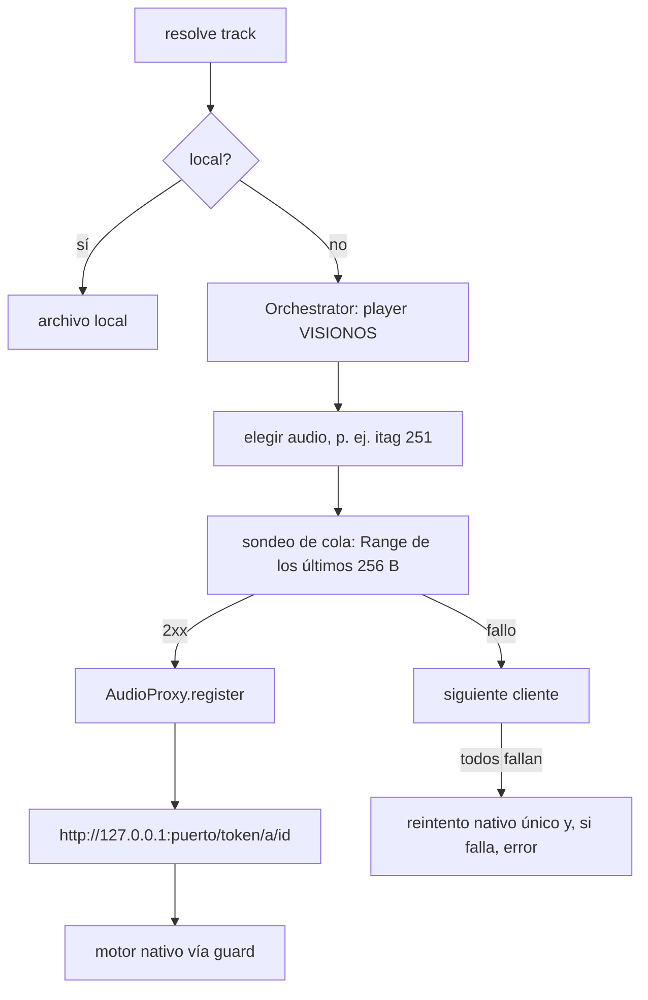

# Motor de audio de YouTube: InnerTube + proxy local

La reproducción de YouTube usa el endpoint `player` de InnerTube con el cliente
**VISIONOS** (como LIMusic). El motor nativo reproduce a través de un proxy de
bucle local. No existe reproductor web ni respaldo: si la resolución nativa falla,
el usuario ve el error de reproducción normal.

Sigue sin existir: tokens PO / BotGuard, descifrado de firma o `n`, saltarse
restricciones Premium, ni pasar una URL cruda de YouTube a Symphonia/Media3.

## Piezas

| Pieza | Papel |
| --- | --- |
| [`InnerTubeSource`](../lib/sources/innertube_source.dart) | Búsqueda (canciones, álbumes, artistas, vídeos, continuación). `resolve()` crea de forma perezosa orquestador y proxy y devuelve la URL del proxy. |
| [`StreamOrchestrator`](../lib/sources/stream/stream_orchestrator.dart) | `POST /youtubei/v1/player` sin clave de API; elige formato de audio, valida con sondeo de cola, caché LRU (50) y TTL de clientes malos. |
| [`player_clients.dart`](../lib/sources/stream/player_clients.dart) | Tabla escrita a mano de clientes (VISIONOS primario). Solo sirven formatos con `url` plana; los de `signatureCipher` se omiten. |
| [`AudioProxy`](../lib/sources/stream/audio_proxy.dart) | Servidor `127.0.0.1`: sirve el rango pedido en trozos de 4 MiB, renueva la URL si caduca o da 401/403/410 y reintenta el trozo. |
| [`ResolvedStream`](../lib/sources/stream/resolved_stream.dart) | Resultado: URL, cabecera `User-Agent`, `expiresAt`, cliente, itag, longitud. |
| [`stream_guard.dart`](../lib/audio/stream_guard.dart) | `assertNotRawYouTube`: error si el decodificador o Media3 reciben youtube.com, googlevideo.com, ytimg.com, etc. Solo se admiten archivos locales y `http://127.0.0.1:<puerto>/...`. |

Motores: Android Media3 (`AndroidMusicAudio`) y escritorio, el motor Rust
(`RustMusicAudio`). Los dos admiten ecualizador y espectro con archivos locales y
con YouTube vía proxy. El motor Rust (`http.rs`) verifica TLS con el almacén del
sistema, corta las lecturas a los 15 s y reconecta con `Range` (3 intentos).

## Flujo

## Matriz de fallos

| Situación | Respuesta |
| --- | --- |
| 403/401/410 de googlevideo a mitad de reproducción, o URL a punto de caducar (margen 30 s) | El proxy renueva (`forceRefresh`, mismo itag, una sola renovación por vídeo) y reintenta el trozo una vez. |
| La renovación falla o cambia la longitud | Sin cabeceras enviadas: `410`. Con cabeceras enviadas: corta el socket. La app lo trata como recuperable y vuelve a resolver. Nunca 403/502 hacia el reproductor. |
| Flujo truncado (menos bytes que la longitud) | `validateCompletion` falla con «Premature EOF»; el controlador recupera la pista. |
| Bot/login (`blocked`, `accessDenied`) u otra respuesta inesperada en todos los clientes | `resolve()` reintenta una vez con `forceRefresh` y, si vuelve a fallar, lanza el error real. |
| Transitorio (red, tiempo agotado, DNS) o no disponible (UNPLAYABLE, retirado) | Error normal con reintento del controlador; sin reintento extra en `resolve()`. |
| Cliente con 403 o sondeo fallido | Se marca malo 10 min (2 min si es error de red); se prueba el último. |

## Qué se permite y qué sigue prohibido

- Permitido: `player` de InnerTube con el cliente VISIONOS y cabeceras propias del
  cliente; `visitorData` desde `sw.js_data`; formatos con `url` plana; proxy de bucle
  local (solo `127.0.0.1`, nunca `localhost`).
- Prohibido: tokens PO / BotGuard, descifrado de firma o `n`, saltarse restricciones
  de Premium, pasar URLs crudas de YouTube/googlevideo al decodificador, guardar
  secretos. yt-dlp, solo descargas explícitas e importación de listas.
- Android: `network_security_config.xml` permite texto claro únicamente a
  `127.0.0.1`; `AuroraPlaybackService` acepta `http` solo con host `127.0.0.1`,
  puerto y sin usuario.

## Pruebas y verificación

- Sonda real: `dart run tool/probe_innertube_clients.dart <videoId>`.
- Pruebas: `test/stream_orchestrator_test.dart`, `test/audio_proxy_test.dart`,
  `test/stream_guard_test.dart`, `test/audio_math_test.dart`,
  `test/innertube_source_test.dart`, `test/stream_recovery_controller_test.dart`
  y `test/stream_engine_integration_test.dart`.
- **Requiere verificación en dispositivo (Android no verificado)**: canción normal;
  URL caducada (pausa > 6 h o forzarla con el depurador); segundo plano/pantalla
  apagada y notificación.

Comportamiento inspirado en LIMusic/Metrolist (GPL-3.0); implementación propia, sin código copiado.
